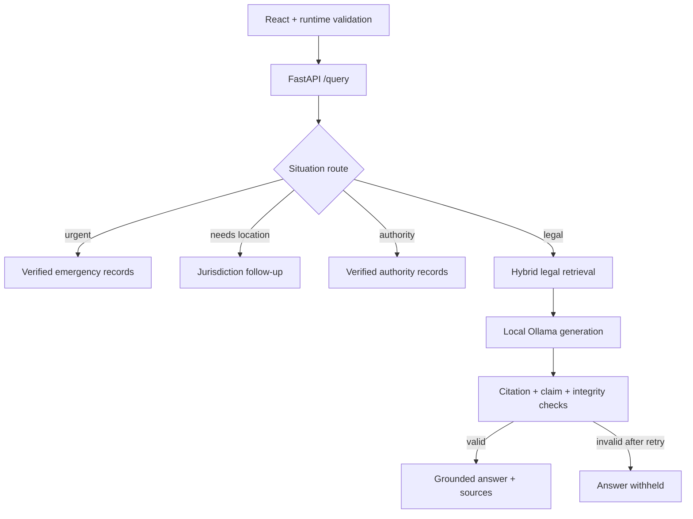

# NyayaAI

NyayaAI is a portfolio-stage Indian legal and civic assistance platform. It classifies a user's situation, routes urgent and jurisdiction-dependent requests before generation, retrieves verified legal evidence, and withholds generated legal answers that fail citation, claim-grounding, or answer-integrity checks.

This repository is a development preview, not legal advice and not a production deployment.

## What is working

- Situation-aware routing across emergency, follow-up, authority, civic, out-of-scope, legal, and non-RAG paths.
- Jurisdiction-aware authority lookup with verified, active records only.
- Deterministic emergency guidance that bypasses the language model and returns only verified contacts from the database.
- Exact Constitution Article and Preamble resolution, including a deterministic response when a requested Article is unavailable.
- Hybrid legal retrieval using pgvector similarity, PostgreSQL full-text search, reciprocal-rank fusion, and semantic reranking.
- Evidence IDs carried into the generated answer and independently checked by citation, claim-grounding, and answer-integrity validators.
- One controlled correction attempt over the same evidence, followed by fail-closed answer blocking.
- A React interface that validates the API response at runtime and never renders blocked drafts or unsafe source links.

## Current verified scope

| Area | Current status |
|---|---|
| Legal corpus | Bharatiya Nyaya Sanhita, 2023 and the Constitution of India |
| Authority directory | Verified records currently demonstrated for India and Assam |
| Emergency directory | Verified national 112 record |
| Civic route | Recognised and safely labelled as not yet available |
| Local generation model | Ollama `llama3.2:3b` |
| Embeddings | Ollama `nomic-embed-text` |
| Reranker | `BAAI/bge-reranker-base` through Sentence Transformers |
| Backend verification | 358 automated tests passing on 9 October 2026 |
| Frontend verification | 33 Playwright tests and a production build reported passing |
| Integrated acceptance | Final portfolio gate passed 14/14 live cases with 0 failures and 0 errors |

The final live matrix covered out-of-scope and civic routing, a missing-jurisdiction follow-up, verified and unavailable authority results, fire and immediate personal-safety emergencies, missing and existing constitutional references, the Preamble, theft definition and punishment, and the qualified assault-without-provocation path. Every generated answer in the gate passed citation, claim-grounding, and answer-integrity validation. Deterministic routes completed in under a second; tested generated answers completed in approximately 6–27 seconds on the development machine.

## Architecture



For implementation detail and design decisions, see [Architecture](docs/ARCHITECTURE.md). For a recruiter-facing explanation, see the [Portfolio case study](docs/PORTFOLIO_CASE_STUDY.md) and [Interview guide](docs/INTERVIEW_GUIDE.md). The [verification evidence](docs/VERIFICATION_EVIDENCE.md) records the final measured results, and the [demo runbook](docs/DEMO_RUNBOOK.md) gives the exact local startup and presentation sequence.

## Local setup

Prerequisites:

- Python 3.13 and a virtual environment
- Docker Desktop
- Ollama with `llama3.2:3b` and `nomic-embed-text`
- Node.js compatible with `frontend/package.json`

From the cloned repository root in PowerShell:

```powershell
Copy-Item .env.example .env
docker compose up -d postgres
ollama pull llama3.2:3b
ollama pull nomic-embed-text
```

The values in `.env.example` are local-development defaults. Replace `JWT_SECRET` and review database, CORS, logging, and rate-limit settings before sharing any deployment.

Start the backend in a second terminal:

```powershell
Set-Location .\backend
python -m venv .venv
.\.venv\Scripts\Activate.ps1
python -m pip install --upgrade pip
python -m pip install -r requirements.txt
python -m alembic upgrade head
python -m uvicorn app.main:app --reload --host 127.0.0.1 --port 8000
```

The checked-in source does not fabricate legal, authority, or emergency records. Use the existing project ingestion and seeding workflows only with the verified datasets intended for this installation.

Start the frontend in a third terminal:

```powershell
Set-Location .\frontend
npm ci
npm run dev
```

Open `http://localhost:3000`. Backend health endpoints are `http://127.0.0.1:8000/health` and `http://127.0.0.1:8000/health/db`.

## Verification

Backend:

```powershell
Set-Location .\backend
.\.venv\Scripts\Activate.ps1
python -m pytest -q
```

Frontend:

```powershell
Set-Location .\frontend
npx playwright install chromium
npm test
npm run build
```

The verified backend baseline for this checkpoint is 358 passing tests. Always report the output from the current checkout rather than assuming the count after future changes.

## API surface

| Method | Path | Purpose |
|---|---|---|
| `POST` | `/query` | Main situation-aware orchestration endpoint |
| `POST` | `/emergency/analyze` | Emergency classification and verified contacts |
| `POST` | `/auth/register` | Register a user |
| `POST` | `/auth/login` | Obtain an access token |
| `GET` | `/users/me` | Return the authenticated user |
| `GET` | `/users/admin-test` | Exercise the admin authorization dependency |
| `GET` | `/health` | Application health |
| `GET` | `/health/db` | Database connectivity |

## Repository layout

```text
backend/   FastAPI application, migrations, ingestion scripts, and tests
frontend/  React/Vite interface and Playwright tests
docs/      Architecture, case study, interview notes, and limitations
data/      Local legal-data workspace; raw/processed files are not committed
```

## Important limitations

The legal and geographic coverage is intentionally narrow, civic-service guidance is incomplete, and generated output is not a substitute for a lawyer or emergency service. The in-memory rate limiter is not suitable for a multi-instance deployment. Model latency is hardware-dependent. The supplied State Emblem asset and its public-release implications must be reviewed before publishing the application. This repository also has no public software licence yet.

See [Known limitations](docs/KNOWN_LIMITATIONS.md) for the full release boundary.
