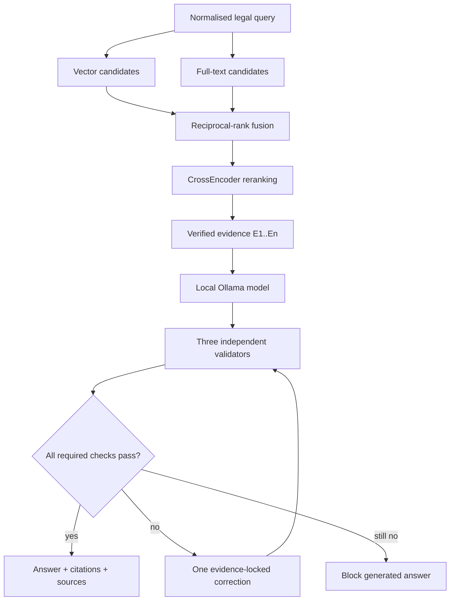

# NyayaAI architecture

## Design objective

NyayaAI is designed around a simple safety rule: route first, retrieve verified material when needed, generate only from that material, and withhold an answer when post-generation checks fail.

## Request flow

1. `POST /query` receives a question and optional jurisdiction.
2. The query analyzer assigns an intent, domain, jurisdiction state, and follow-up requirement.
3. The orchestrator short-circuits requests that should not enter legal generation:
   - high-confidence immediate emergencies use deterministic actions and verified emergency records;
   - missing location returns a follow-up;
   - directory requests query verified authorities;
   - general civic and out-of-scope requests return their own bounded responses.
4. Exact Constitution references are resolved structurally. An unavailable Article is reported as unavailable instead of being replaced with a nearby semantic match.
5. A legal request enters the retrieval and validation pipeline described below.

Immediate violent-threat detection is deliberately conjunctive: it requires threat language, a violent-harm verb, a first-person target, and an immediate-time marker. Historical threats and general questions about threat law therefore remain outside the emergency path. Exact Article parsing similarly accepts bounded constitutional identifiers such as `21`, `21A`, `239AA`, `243-I`, and `243Z-I` without consuming following words such as “of”.

## Legal retrieval and generation

Vector retrieval uses pgvector embeddings. Lexical retrieval uses PostgreSQL full-text search. Reciprocal-rank fusion combines the two candidate lists without treating their raw scores as directly comparable. The fused candidates receive a semantic reranking signal from `BAAI/bge-reranker-base`; the final evidence list is limited before prompting.

The generator receives evidence IDs rather than unlabelled context. Generated citations are accepted only when they reference supplied evidence. The controlled retry reuses the same verified evidence; it is correction, not a second retrieval or an invitation to invent a new source.

## Validation boundaries

| Check | Purpose |
|---|---|
| Citation validation | Referenced evidence IDs exist and citations match the generated answer structure |
| Claim grounding | Material legal claims are supported by cited evidence |
| Answer integrity | Penal consequences and qualified rules are not silently merged, softened, or omitted |

The frontend independently enforces the final response contract with Zod. It does not display a blocked draft, even if a malformed response accidentally includes one, and it permits only safe absolute HTTP(S) source URLs.

## Data and provenance

The database stores legal sources, documents, versions, acts, structured provisions, chunks, embeddings, jurisdictions, authorities, emergency contacts, users, citations, and audit logs. Legal evidence is filtered by verification and active-version status. Authority and emergency records must be both verified and active before they are returned.

The current database audit established:

- the Alembic database revision matched the single head;
- pgvector was active;
- 1,532 legal chunks were embedded and searchable;
- the active BNS version was linked to its verified Gazette source;
- no empty chunks, missing content hashes, or duplicate chunk content were found.

## Final verification checkpoint

On 1 October 2026, the backend suite passed 358 tests. A focused C20 routing/reference suite passed 77 tests, its three corrected live paths passed 3/3, and the final portfolio matrix passed 14/14 cases with no failures or runtime errors. The matrix included verified directory responses, fail-closed exact-reference behavior, emergency short-circuiting, BNS Sections 303 and 131, Article 21, and the Constitutional Preamble.

## Technology choices

| Layer | Choice | Reason |
|---|---|---|
| API | FastAPI | Typed async API and explicit response models |
| Persistence | PostgreSQL + SQLAlchemy | Relational provenance, constraints, and async access |
| Search | pgvector + PostgreSQL FTS | Semantic and exact-term retrieval in one database |
| Generation | Ollama | Local inference and inspectable model configuration |
| Reranking | Sentence Transformers CrossEncoder | Stronger pairwise relevance signal after broad retrieval |
| UI | React + TypeScript + Zod | Typed interaction plus runtime validation of untrusted JSON |
| Browser testing | Playwright | Route, failure-mode, accessibility, and responsive-flow coverage |

## Operational characteristics

Backend startup can preload the generation, embedding, and reranking models. This makes startup heavier but reduces first-query latency. Warm-up failures are logged; deterministic routes can still start, while model-dependent routes remain observable through their errors and validation results.

The current rate limiter is process-local. A production, multi-instance deployment would need a shared limiter, centralised observability, secret management, backups, and a controlled legal-data update process.
